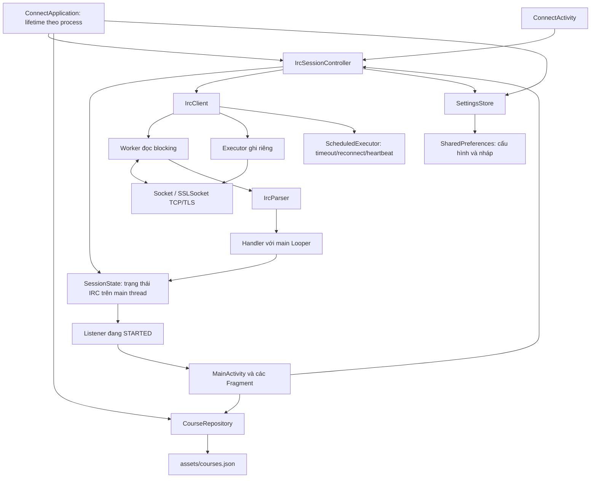
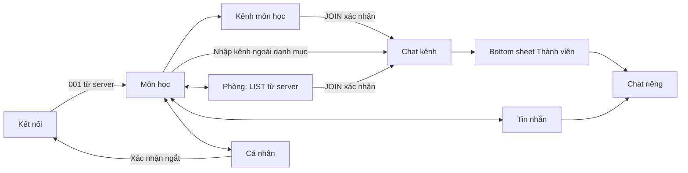

# Kiến trúc và luồng dữ liệu

## Kiến trúc

Repository giữ application settings và listener đã đăng ký; không giữ Activity/View. Fragment và Activity đăng ký trong `onStart`, hủy trong `onStop`. View chỉ cập nhật trên main thread. IrcClient thuần Java; state thuần Java; Android Handler nằm ở lớp repository để test logic độc lập.

## Điều hướng

MainActivity sử dụng FragmentManager và back stack. Trạng thái Fragment/Bundle và view hierarchy được Android lưu khi xoay. Chat lưu target, mốc chưa đọc và Parcelable của LinearLayoutManager; nháp ở SettingsStore. Không khai báo `configChanges` để né vòng đời. Một Application giữ nguyên IrcSessionController và socket khi Activity được tạo lại.

Điều hướng chính hiện có ba tab Môn học, Tin nhắn, Cá nhân. ServerChannelsFragment được mở qua nút Phòng trên server trong Môn học hoặc `/list`; có nút Back và vẫn gọi LIST thật. Chat kênh chọn tab Môn học, PM chọn tab Tin nhắn. Thanh tab hiện khi duyệt và ẩn khi bàn phím mở. WindowInsetsHelper áp dụng khoảng chừa system bars/IME cho root.

UI tiếp tục dùng XML + Material + RecyclerView; không thêm Compose hoặc ViewModel. CatalogAdapter dùng lại card môn/kênh/hội thoại/thành viên. ChatAdapter nhóm tin cùng tác giả trong 5 phút nếu không có ranh giới ngày, tin chưa đọc hoặc sự kiện; DM căn trái/phải theo outgoing thật. Không sửa engine IRC, repository, model hay storage. Xem [UI_REDESIGN.md](UI_REDESIGN.md).

## Luồng gửi

1. Người dùng bấm Gửi. ChatFragment gộp xuống dòng thành khoảng trắng. SlashCommand tách lệnh gõ thành thao tác typed; tin thường gọi IrcSessionController.send. // gửi dấu / nguyên văn.
2. IrcCommands kiểm tra target, CR/LF/NUL, nội dung trống và kích thước UTF-8 của cả dòng <= 512 byte với CRLF.
3. Repository thêm một hàng QUEUED của chính mình, gọi IrcClient.send. Nút gửi chỉ khả dụng khi CONNECTED và nếu là kênh thì JOIN đã xác nhận.
4. Writer executor ghi UTF-8 và CRLF, flush socket. Handler nhận kết quả, đổi sang WRITTEN. Mọi cập nhật adapter nằm trên main thread.
5. Numeric 401/404 hoặc lỗi tương ứng cập nhật tin gần nhất cho target thành FAILED. Vì IRC cổ điển không có ID/ACK cho từng tin, tương quan lỗi là best-effort theo target và cửa sổ 30 giây; không phải read receipt.
6. Lỗi ghi một phần => UNCERTAIN. Mất kết nối không phát lại hàng. Người dùng tự bấm Thử lại, đọc xác nhận khả năng trùng, rồi gửi lại đúng hàng đó.

## Luồng nhận

1. Reader nhận bytes từ socket; gom theo CRLF với giới hạn incoming 8192 byte để chấp nhận tag; EOF giữa dòng hoặc framing sai đóng phiên.
2. Parser tách tags/source/command/parameters/trailing. Dòng sai grammar bị bỏ qua. `PING` được trả lời `PONG` qua writer riêng.
3. `001` chấp nhận phiên và nickname. Socket đã mở/TLS handshake thành công vẫn chỉ là CONNECTING/REGISTERING trước bước này.
4. Callback mang epoch được Handler chuyển về main; callback của phiên cũ bị loại sau hủy/reconnect.
5. SessionState xử lý JOIN/PART/KICK/QUIT/NICK; NAMES 353/366; LIST 321/322/323; TOPIC/331/332; MODE/324; WHO 352; AWAY/301/305/306; PRIVMSG và lỗi numeric. Prefix/CHANMODES lấy từ 005. CAP thương lượng multi-prefix/away-notify trước 001; server không hỗ trợ CAP vẫn đăng ký bằng NICK/USER.
6. NAMES nhiều gói được gom vào map có khóa nickname chuẩn hóa; PART/QUIT giữa gói dùng tombstone để không phục hồi người đã rời. Đến 366 mới thay danh sách hoàn chỉnh.
7. Tin đến target khác chat đang mở tăng unread. Mở chat đánh dấu đọc cục bộ; không gửi trạng thái “đã đọc” cho server.
8. Fragment render thông qua listener. Nếu đang đọc cũ, adapter giữ vị trí cuộn và hiện nút xuống tin mới; nếu đang ở cuối thì cuộn tiếp.

## Reconnect và bảo mật

Mỗi lần kết nối có generation/epoch mới. Hủy đóng socket và hủy timer, tránh callback cũ làm thay đổi phiên mới. Reader/writer riêng để đọc blocking không giữ hàng đợi gửi. Timeout 30 giây bao gồm connect/TLS/registration; socket connect 15 giây, read timeout 180 giây và PING định kỳ 60 giây với fixed delay.

SSLSocket dùng trust store mặc định và `SSLParameters.setEndpointIdentificationAlgorithm("HTTPS")` để kiểm tra hostname. Không cài trust manager chấp nhận mọi certificate. Lỗi TLS là lỗi dừng để người dùng sửa cấu hình. Các hostname/IP của server phải phù hợp certificate; certificate tự ký chưa được hệ thống tin cậy sẽ bị từ chối.

Cấu hình và nháp dùng `SharedPreferences.apply`, không ghi key/mật khẩu. Không lưu lịch sử giữa server; đổi host/cổng/TLS xóa dữ liệu RAM phiên trước. Bản đầu không triển khai foreground service, database history hoặc đăng nhập tài khoản.

## Tối ưu và phần mở rộng

RecyclerView tái sử dụng view holder, vector icons nhẹ và không tải bitmap mạng. Lịch sử được giới hạn để tránh tăng RAM vô hạn trong mỗi hội thoại. Callback lifecycle giảm leak; một socket dùng cho mọi kênh. UI layout co giãn, các danh sách cuộn và bàn phím dùng WindowInsetsCompat.

Các adapter hiện cập nhật danh sách nhỏ bằng `notifyDataSetChanged` có giữ anchor. Đây là lựa chọn đơn giản của bản đồ án; DiffUtil/ListAdapter, phân trang SQLite, đọc server-time, ISUPPORT đầy đủ và foreground service là các hướng mở rộng được nêu rõ, không được xem là đã có.

## Trạng thái bổ sung

ServerChannelsFragment đọc availableChannels, độc lập với CourseRepository/courses.json. LIST/NAMES có trạng thái tải và timeout; không ghi nhận phòng hay quyền bằng dữ liệu mẫu. MODE cập nhật cả members lẫn namesBatch để không mất thay đổi quyền khi NAMES chưa kết thúc.

WHO lấy presence ban đầu; AWAY cập nhật trực tiếp khi đã thương lượng away-notify. NICK đổi khóa presence, QUIT/mất kết nối xóa presence. Hộp thông tin PM đăng ký listener trong lúc mở và hủy khi đóng/Activity bị hủy.

NicknameMentions giữ chỉ số UTF-16 khi fold nickname theo RFC1459, dùng ranh giới nickname. ChatAdapter tô các vùng được nhắc; ConnectApplication dùng notification channel mentions có importance HIGH khi app ở nền.

## Chuyển chế độ sáng/tối

`view_theme_toggle.xml` được dùng ở header đăng nhập, danh mục, chat và cá nhân. `UiHelpers.themeToggle` đọc uiMode hiện tại, đổi icon/nhãn rồi lưu boolean darkMode qua SettingsStore. `AppTheme.apply` cập nhật UiModeManager (API 31+) và AppCompatDelegate; màn hình được tái tạo với resources `values-night`, giữ session trong Application và state/nháp như khi xoay. ConnectApplication áp dụng lựa chọn lưu trước khi Activity được mở.

Màu nền/chữ/viền và icon status/navigation có bản night. Màu nền nút, avatar và màu chữ trắng được tách khỏi surface để giữ độ tương phản. Logo gốc nằm trên nền trắng nhỏ ở cả hai chế độ.

Tham khảo [Android dark theme](https://developer.android.com/develop/ui/views/theming/darktheme).

## Tra cứu source sau đợt làm sạch

Các dialog nằm trong `ui/dialog/`: ChannelDialogs cho kênh/phòng, UserDialogs cho thành viên/PM/away, CommonDialogs cho xác nhận/nhập liệu/help. SessionState.accept() điều phối tới các handler có tên theo sự kiện; ChatFragment.render() gọi các bước nhỏ theo phần màn hình. IrcSessionController dùng mainHandler và notifyListeners() để cập nhật UI. Xem [CODE_MAP.md](CODE_MAP.md) để tìm từng tính năng.
